<p align="center">
  
</p>

# github-readme-svg

[English](README.md) | **한국어**

GitHub 프로필/저장소 README에 넣을 **애니메이션 SVG 배너** 생성기입니다.
JavaScript 없이 CSS 애니메이션과 SMIL만 써서 GitHub에서 그대로 재생됩니다.
모든 스타일이 `prefers-reduced-motion` 설정을 따릅니다.

## 스타일

### `synthwave`
네온 타이틀이 선으로 그려진 뒤 빛나며 깜빡이고, 레트로 줄무늬 태양과 다가오는 원근 그리드가 배경에 깔립니다.


### `matrix`
깊이감 있는 코드 비, RGB가 갈라지는 글리치 타이틀, 타이핑 효과 부제목.


### `orbit`
기술 스택 태그가 이름 주위를 3D 궤도로 돌고, 뒤로 갈수록 작고 흐려집니다. 가운데에는 맥동하는 코어가 있습니다.



### `banner`
그라디언트 타이틀, 여러 문구를 번갈아 타이핑하고 지우는 효과, 반짝이는 별, 떠다니는 원, 흘러가는 물결.


## Contribution graph 스타일

실제 GitHub contribution 기록으로 만듭니다. 데이터는 공개 페이지 `github.com/users/<user>/contributions`에서 가져오므로 토큰이 필요 없습니다.
두 스타일 모두 총 기여 수, 현재·최장 연속 기록, 최고 기록일을 숫자가 올라가는 애니메이션으로 보여줍니다.

### `contrib-grid`
익숙한 잔디 그리드입니다. 칸들이 대각선 물결로 튀어나온 뒤, 스캔 빔이 지나가며 빛의 잔상을 남깁니다.



### `contrib-city`
1년을 3D 도시로 보여줍니다. 하루가 건물 하나이고 높이는 그날 기여 수를 따르며, 도시가 물결처럼 솟아오릅니다.



팔레트: `--palette green | halloween | ice | neon`

```sh
nix run . -- --style contrib-grid --user <GitHub-사용자-이름>
nix run . -- --style contrib-city --user <GitHub-사용자-이름> --palette neon
```

### GitHub Actions로 자동 갱신

`.github/workflows/contrib.yml`이 매일 00:00 UTC에 Nix로 두 SVG를 다시 만들고, 바뀐 게 있으면 커밋합니다.
사용자 이름은 저장소 소유자로 정해집니다. **Actions** 탭에서 **Run workflow**로 직접 실행할 수도 있습니다.
**Settings → Actions → General → Workflow permissions → Read and write** 설정이 필요합니다.

## 사용법 (Nix)

```sh
# 모든 스타일을 assets/에 생성
nix run . -- --style all --name "Hi, I'm Jihoo"

# 스타일 하나만
nix run . -- --style orbit --name "Jihoo" \
  --line "Full-stack tinkerer" \
  --tag Python --tag Nix --tag Rust --tag Linux

nix run . -- --style matrix \
  --line "Welcome to my GitHub!" --line "I love building cool stuff"

# 개발 셸 (python3 + rsvg-convert)
nix develop
python3 generate.py --help
```

| 옵션 | 설명 | 기본값 |
|---|---|---|
| `--style` | `banner` · `synthwave` · `matrix` · `orbit` · `contrib-grid` · `contrib-city` · `all` | `banner` |
| `--user` | `contrib-*` 스타일용 GitHub 사용자 이름 (`all`과 함께 쓰면 contrib 스타일도 생성) | — |
| `--palette` | `green` · `halloween` · `ice` · `neon` (`contrib-*`) | `green` |
| `--contrib-html` | 가져오는 대신 저장해 둔 contributions HTML 사용 | — |
| `--name` | 큰 타이틀 | `Hi, I'm Jihoo` |
| `--line` | 부제목 문구, 여러 번 지정 가능 (`banner`/`matrix`는 모두 타이핑, `synthwave`/`orbit`은 첫 줄만 사용) | 예시 문구 3개 |
| `--tag` | `orbit` 스타일에서 궤도를 도는 태그, 여러 번 지정 가능 | Python, Nix, Linux, … |
| `--theme` | `aurora` · `sunset` · `ocean` (`banner`, `orbit`) | `aurora` |
| `--seed` | 별/코드 비 배치용 랜덤 시드 | `42` |
| `--out` | 출력 경로 (스타일 하나일 때만) | `assets/<style>.svg` |

## README에 넣기

생성한 SVG를 저장소에 커밋한 뒤 README에 다음을 넣으세요.

```html
<p align="center">
  
</p>
```

> `--line`, `--tag` 문구 폭은 글꼴 크기로 추정합니다. 영문이 가장 정확하고, 한글 등 전각 문자는 대략 맞습니다.
