<p align="center">
  
</p>

# github-readme-svg

**English** | [한국어](README.ko.md)

A generator for **animated SVG banners** to put in your GitHub profile or repository README.
No JavaScript: it uses only CSS animations and SMIL, so the banners play as-is on GitHub.
CSS-driven motion stops under `prefers-reduced-motion` (SMIL animations, which browsers cannot pause from CSS, keep playing).

## Styles

### `synthwave`
A neon title that draws its own outline, then lights up and flickers. Behind it are a retro striped sun and a perspective grid that scrolls toward you.


### `matrix`
Falling code rain at several depths, a title with RGB-split glitches, and a typewriter subtitle.


### `orbit`
Your tech stack orbits your name in 3D-style ellipses, with tags shrinking and dimming as they pass behind. A pulsing core sits in the centre.



### `banner`
A gradient title, a typewriter effect that types and erases several lines in turn, twinkling stars, floating orbs and flowing waves.


### `splitflap`
An airport split-flap board. Every cell clatters through random letters before landing, the top flap
falling onto the hinge at each flip. The name refreshes once per loop and each `--line` takes a turn on the
lower row; cells that do not change stay still, like a real board. Your first tags go in the header.



### `swarm`
Fireflies drift over a night meadow, then swarm together to spell your name in glowing dots, hover for a
moment and scatter again. The grass sways in front of and behind them.


### `liquid`
Your name as molten metal. Blobs rise out of a sloshing pool, melt into the letters and drip back down, with
a moving specular highlight on the liquid surface (a gooey filter plus SVG lighting).


### `scope`
A CRT oscilloscope. The electron beam writes your name stroke by stroke in phosphor, while the trace below
morphs between sine, square, heartbeat and AM waveforms. Knobs twitch, the trigger LED blinks.
`--theme` picks the phosphor: `aurora` green, `sunset` amber, `ocean` cyan.



### `blueprint`
An engineering drawing. Construction lines are laid out first, a pen plotter draws your name, then it gets
dimensioned and called out as "DETAIL A". The title block holds your name and first line, the tags run along
the bottom.



## Contribution graph styles

Built from your real GitHub contribution calendar, fetched from the public page `github.com/users/<user>/contributions` (no token needed).
They show total contributions, streaks and your best day, with numbers that count up.

### `contrib-grid`
The familiar grid. Cells pop in on a diagonal wave, then a scanning beam sweeps across and leaves a fading trail of light.



### `contrib-city`
Your year as a 3D city. Each day is a building whose height follows its contribution count, and the city rises in a wave.



### `contrib-galaxy`
Your year as a turning spiral galaxy. Each day is a star on one of two arms, a year ago at the rim and today
at the glowing core. Brightness follows the day's count, your busiest days get diffraction spikes, and the
stars ignite in date order from the rim inward.



### `contrib-heartbeat`
A patient monitor. Every week is one heartbeat whose spike is as tall as that week's contributions; idle weeks
flatline. The sweep moves at constant speed with a bright head and an erase gap, like a real monitor, next to
readouts for weekly average, total, streak and peak day.



Palettes: `--palette green | halloween | ice | neon`

```sh
nix run . -- --style contrib-grid --user <your-github-username>
nix run . -- --style contrib-city --user <your-github-username> --palette neon
nix run . -- --style contrib-galaxy --user <your-github-username> --palette ice
nix run . -- --style contrib-heartbeat --user <your-github-username>
```

### Auto-update with GitHub Actions

`.github/workflows/contrib.yml` regenerates the contrib SVGs every day at 00:00 UTC using Nix, and commits them if they changed.
It uses the repository owner as the username. You can also run it by hand from the **Actions** tab (**Run workflow**).
It needs **Settings → Actions → General → Workflow permissions → Read and write**.

## Usage (Nix)

```sh
# Generate every style into assets/
nix run . -- --style all --name "Hi, I'm Jihoo"

# A single style
nix run . -- --style orbit --name "Jihoo" \
  --line "Full-stack tinkerer" \
  --tag Python --tag Nix --tag Rust --tag Linux

nix run . -- --style matrix \
  --line "Welcome to my GitHub!" --line "I love building cool stuff"

# Dev shell (python3 + rsvg-convert)
nix develop
python3 generate.py --help
```

| Option | Description | Default |
|---|---|---|
| `--style` | `banner` · `synthwave` · `matrix` · `orbit` · `splitflap` · `swarm` · `liquid` · `scope` · `blueprint` · `contrib-grid` · `contrib-city` · `contrib-galaxy` · `contrib-heartbeat` · `all` | `banner` |
| `--user` | GitHub username for `contrib-*` (with `all`, also generates the contrib styles) | — |
| `--palette` | `green` · `halloween` · `ice` · `neon` (`contrib-*`) | `green` |
| `--contrib-html` | Use a saved contributions HTML page instead of fetching it | — |
| `--name` | Large title | `Hi, I'm Jihoo` |
| `--line` | Subtitle lines, repeatable (`banner`/`matrix`/`splitflap` use all of them; the others use the first) | 3 sample lines |
| `--tag` | Tags, repeatable (`orbit` orbits them; `splitflap`/`blueprint` print them) | Python, Nix, Linux, … |
| `--theme` | `aurora` · `sunset` · `ocean` (`banner`, `orbit`, `splitflap`, `liquid`, `scope`) | `aurora` |
| `--seed` | Random seed for stars / code rain | `42` |
| `--out` | Output path (single style only) | `assets/<style>.svg` |

## Adding it to your README

Commit the generated SVG to your repository, then add this to your README:

```html
<p align="center">
  
</p>
```

> `swarm`, `scope` and `blueprint` draw the name with a built-in single-stroke font (`vecfont.py`) that covers
> A–Z, 0–9 and common punctuation; lowercase is drawn as uppercase and other characters are left blank.

> Text width for `--line` and `--tag` is estimated from the font size. It is most accurate for English text; Korean and other wide characters are approximate.
